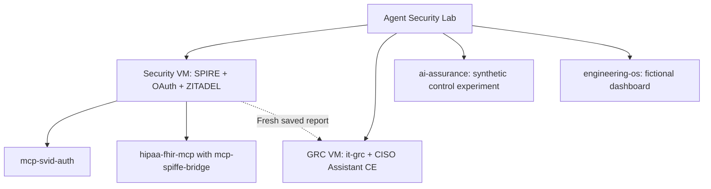

# Agent Security Lab

**Passkeys for people. Short-lived identity for agents. Evidence you can inspect.**

| For a CISO | |
|---|---|
| Problem | AI agents call tools with static API keys and broad grants. One poisoned tool response or leaked key turns into access to everything the key can reach. |
| What the lab shows | Agents authenticate with SPIFFE workload identity, receive 5-minute tokens bound to one resource and a narrow scope set, and humans sign in with passkeys. When an agent obeys an injected instruction, out-of-scope calls are denied and recorded. |
| Evidence | Asserted scenarios that fail on unexpected success, credential-free reports and hash-chained audit lines: [validation](docs/validation.md), the `mcp-svid-auth` tool response poisoning scenario (`make attack-scenarios`), and the [remaining long-lived secrets](#remaining-long-lived-secrets). |

Containment is not detection: the lab does not detect or strip prompt injection, and an agent can still be steered inside its own grant.

One local panel for six security projects: start demos, browse Kubernetes, inspect
health and versions, and follow the evidence. Apache-2.0.

[](https://tanya-ok.github.io/agent-security-lab/)

The Pages link is the planned URL; the site has not been published.
[Read the local documentation](docs/index.md) or preview it with
`uv run --locked --group docs zensical serve`.

## What we use

| Component | Role in the lab |
|---|---|
| [Headlamp](https://headlamp.dev/) | Read-only Kubernetes viewer. A [CNCF Sandbox project](https://www.cncf.io/projects/headlamp/). |
| [Lima](https://lima-vm.io/) + [k3s](https://k3s.io/) + [containerd](https://containerd.io/) | Local Linux VMs, Kubernetes and container runtime. This is our Docker-free runtime path. containerd is a [CNCF Graduated project](https://www.cncf.io/projects/containerd/). |
| [Buildah](https://buildah.io/) | Builds OCI images inside the VM. No Docker Desktop or Docker daemon is required. |
| [ZITADEL](https://zitadel.com/) + [passkeys](https://fidoalliance.org/passkeys/) | WebAuthn sign-in for approved viewer access, opt-in organization administration and CISO Assistant SSO, without passwords or SMS in these flows. |
| [SPIFFE / SPIRE](https://spiffe.io/) | Short-lived workload identity and scoped OAuth access tokens, without a static agent API key in the tested flow. |
| [Beads](https://github.com/gastownhall/beads) | Local tasks, dependencies and a filtered roadmap. |
| [Zensical](https://zensical.org/) | Documentation with architecture diagrams, prepared locally for GitHub Pages. |

Passkeys contain durable private keys. The lab still has local provisioning
credentials; this is not a claim that every credential is short-lived.

## Development and review models

These are development/review tools, not a model-compatibility matrix for MCP.

| Tool or role | Model | Evidence |
|---|---|---|
| Claude Code | Opus 5.5 | Maintainer-reported development setup; saved CLI reports do not pin the backend model. |
| Codex | Sol 6.1 (`gpt-6.1-sol`) | Local coding configuration checked. |
| Kimi via Moonshot API | `kimi-k2.6` | Model ID recorded in the earlier portfolio quorum reports. |
| Local mechanical triage | `gemma4:26b` | `ask-local` branch-triage invocation completed; its suggestions require verification. |

Local Ollama configuration, inspected:

| Role | Local model tag | Reported parameters / quantization | Context used |
|---|---|---|---|
| `ask-local` default | `gemma4:26b` | 25.2B / Q4_K_M | 32,768 tokens |
| Quorum reviewer | Gemma 4 (`personal-os-gemma-31:64k`) | 30.7B / Q8_0 | 65,536 tokens |
| Quorum reviewer | gpt-oss (`personal-os-gpt-oss-120:64k`) | 116.8B / MXFP4 | 65,536 tokens |
| Quorum chair | Qwen3.5 (`personal-os-qwen-122:64k`) | 125.1B / Q4_K_M | 65,536 tokens |

Parameter counts are Ollama metadata, not inferred from tag names. `ask-local`
sets temperature 0; `quorum` sets 0.3 and requests model unloading after each
response. All three quorum models completed two local review batches.
This is a bounded review, not a complete security audit. Its packet covers selected ranges in 21 files across
seven repositories; omitted code and test bodies remain outside scope. Reviewers
run serially to limit memory pressure.

The custom quorum uses independent reviews followed by a chair summary and
human verification. Google's [ADK multi-agent workflow patterns](https://github.com/google/adk-docs/blob/main/docs/workflows/patterns.md)
are a related reference for gather/synthesis and generator/critic workflows.
This script does not use Google ADK, implement a Google-prescribed voting rule,
or treat model agreement as approval. Local bulk reading and drafts stay local;
code inspection and tests substantiate any accepted finding.

## Remaining long-lived secrets

Agent credentials in the tested flow are short-lived: JWT-SVIDs and access tokens
live at most 5 minutes and token signing keys stay in process memory. These
secrets are not short-lived:

| Secret | Where | Lifetime |
|---|---|---|
| Operator and viewer passkeys | Authenticator devices | Durable by design; recovery is a second enrolled key |
| ZITADEL masterkey, database passwords, cookie secret and first administrator password | Kubernetes Secret in the owned identity namespace | Until the identity profile is recreated; no rotation |
| ZITADEL bootstrap owner and Login PATs | Owned identity profile | Two days; the owner PAT has broad privileges and is not renewed automatically |
| Google OAuth client secret (optional) | Owner-only ignored file, only when Google sign-in is configured | Until rotated at the provider |
| IT GRC administrator password | Owner-only ignored file in `it-grc` | Until rotated with `grc-rotate-admin` |
| CISO Assistant OIDC signing key | Kubernetes Secret in the IT GRC VM | Until regenerated |
| k3s administrator kubeconfig | Inside each VM, mode 0600 | k3s client certificate validity; not tracked by the lab |

The IT GRC bridge token lasts one day. None of these secrets is committed or printed.

## Try it locally

[Validation](docs/validation.md): the latest full local run after SSO configuration passed all 24 stages plus SSO checks; owner profile preserved.
[Manual walkthrough](docs/manual-walkthrough.md): where to click and what to expect.
[Viewer recovery](docs/viewer-validation.json): namespace-scoped browsing checked.
[Owner acceptance](docs/viewer-owner-acceptance.json): real passkey sign-in and Pods, Deployments and Services confirmed.
[Publication review draft](docs/publication-plan.md): scope, validation limits and publication gates.
[Article draft](docs/articles/goodbye-sms-and-passwords.md): passkeys and short-lived workload credentials.

```sh
./lab doctor
./lab prepare
./lab up
```

Open **http://127.0.0.1:18879/**. After initial setup, use the panel without a terminal:

| Button | Effect |
|---|---|
| **Start stack** | Start or reuse this lab's VMs and demo interfaces |
| **Run all demos** | Start/reuse services, then run every demo and collect fresh evidence |
| **Stop stack** | Cancel an active browser run, then stop the owned stack |

The **Versions & health** page at **http://127.0.0.1:18879/runtime** shows live
application checks, verified source pins and observed container image digests.
Version labels are matched to the actual digest. Library and experiment versions
remain separate from continuous service health. Checks refresh every 15 seconds. Service cards and expanded container rows also
provide **Restart** and **View logs**. Restarts are serialized with full demos;
log views show bounded safe diagnostic signals without exporting arbitrary
messages or request data. Components with temporary identity state have individual
restart disabled. Details: [service operations](docs/service-operations.md).

The page also shows the actual expiry of the two synthetic identity credentials.
A warning appears 24 hours before expiry, then changes to Expired. Missing or
ambiguous metadata is Unknown. No automatic renewal or profile reset occurs.

If the security workloads remain ready while local viewer/identity interfaces
are offline, the page offers **Reconnect local access**. This reuses the existing
owned proxy restart and preserves the identity profile and persistent GRC data.
The suggestion is withheld for degraded workloads, unknown state or application
policy/readiness errors. No automatic recovery or reset is performed.

Stop leaves the panel available for the next start. Saved reports and persistent
GRC data remain. Synthetic security/identity state is disposable and recreated on
startup. Live progress and failures appear in the execution trail. Only one
operation can run at a time, including operations started from the CLI.



| Demo | What runs |
|---|---|
| Shared security lab | 18 real SPIRE/OAuth/FHIR allow, deny, expiry and rotation scenarios |
| Human identity | Isolated synthetic WebAuthn/OIDC and closed Google-provider setup; owner profile preserved, no Google contact |
| Bridge package | Independent consumer, real TLS, synthetic certificates and credential-loss recovery |
| FHIR package | Independent installed stdio server, verified local HTTPS, minimization and audit checks |
| IT GRC | Fresh lab report imported into local CISO Assistant; readback, ledger and bounded results verified |
| AI Assurance | Bounded synthetic control experiment; profiles are not installed |
| Engineering OS | Shipped fictional fixture, live dashboard API and graph; no private vault or embedding download |

All source versions are full commits in [lab.lock.json](lab.lock.json).
The local source repositories default to sibling directories. For another layout,
use `./lab --workspace /path/to/source-parent prepare` and the same option on later commands.
Snapshots are made from Git objects, so dirty source worktrees stay unchanged.
Each operation rechecks committed source bytes against those objects. Generated
dependencies and build outputs are local runtime state, not an authenticated supply chain.

| Command | Effect |
|---|---|
| `./lab doctor` | Check prerequisites and materialize/verify locked sources |
| `./lab prepare` | Install frozen dependencies and build local packages/dashboard |
| `./lab up` | Start the isolated stack and local interfaces |
| `./lab demo` | Start/reuse the stack, then execute the full demo sequence |
| `./lab status` | Inspect owned VM state and loopback listeners |
| `./lab report` | Print the latest operation report |
| `./lab reset-security` | Explicit recovery of the disposable security lab after unexpected VM power loss |
| `./lab reset-identity` | Explicit recovery of only the disposable synthetic identity profile |
| `./lab down` | Remove synthetic security namespaces; stop owned services/VMs; retain GRC data |

The first run needs macOS, Python 3.12+, Git, uv, Node 26+, the pinned pnpm
versions, npm, OpenSSL, make and Lima. Public registries and vendor downloads are
needed during setup, including the pinned Playwright Chromium browser for
synthetic WebAuthn acceptance. Two VMs request **2 CPUs and 4 GiB each**; keep at least
20 GiB free disk before the first run. Images and caches use additional disk.
The Linux container runtime is **containerd via k3s**. Buildah builds OCI images.

Runtime files, source snapshots, keys and raw logs stay under ignored `.data/`
with owner-only access. The runner sets a dedicated `LIMA_HOME` here; it never
uses the default Lima home. It forwards no API keys, AWS profile or SSH agent.
Browser-cache garbage collection is disabled during setup.
The loopback hub accepts only three fixed control actions. Each POST requires an
exact local Host, matching Origin and a random per-session token; no arbitrary
commands, paths or arguments are accepted. Raw logs and credentials are not served.
The CLI `down` also closes the panel; the browser's Stop button keeps it running.

- Security viewer: http://localhost:4466/c/main/security-lab (protected sign-in).
- CISO Assistant: https://localhost:18443 (its own local CA; do not disable TLS verification).
- Fictional work dashboard: http://127.0.0.1:18766/.

Synthetic passkey tests run automatically. SPIRE state and identity bootstrap PATs
are intentionally memory-backed. Normal `down` removes their owned synthetic
namespaces before stopping the VM; `up` builds a fresh security profile. After
unexpected power loss, use `./lab reset-security` before `./lab up`. A narrower
`reset-identity` is available for the disposable login profile only. Manual operator passkey enrollment is an explicit local opt-in; see
[operator setup](docs/operator-passkey.md). The registration remains temporary. GRC evidence, saved run
reports, VM disks and image caches remain.

Preserved-profile restart was verified: startup checks the existing
native identity policy and restores only the known empty SPIRE memory state.
The operator passkey and profile are retained. Foreign ownership, partial trust
state or policy failure stops startup without resetting credentials. Normal
`down` still removes the disposable namespaces. See
[restart recovery](docs/restart-recovery.md) and [dated evidence](docs/restart-validation.json).

Real Google sign-in and physical key
enrollment remain separate operator steps. CISO Assistant credentials and CA are
in `.data/checkouts/it-grc/deploy/.data/`; they are never served by the hub.
A passing run is scoped demo evidence, not certification or production readiness.
`ecs-contract` and paid model/quorum calls are excluded.

[Architecture and ownership](docs/architecture.md) · [Development](CONTRIBUTING.md)

[Verified local model-review results](docs/local-model-review.md)

## Documentation publishing

The Pages workflow builds and checks the static documentation. Upload and deploy
require `main`, the `github-pages` environment and the explicit repository variable
`PAGES_ENABLED=true`. Enable them only after reviewing the public output and
approving publication. Workflow preparation alone does not publish a site.
