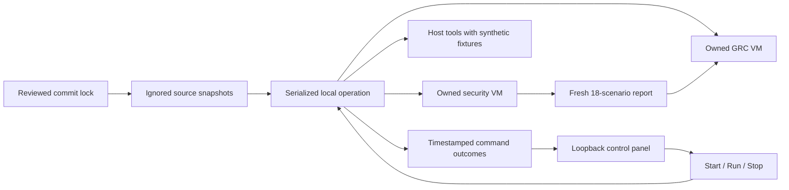

# Ownership and evidence

| Boundary | Owner |
|---|---|
| Source, protocol and application behavior | Each component repository |
| Versions, sequence, private logs and overall run verdict | Agent Security Lab |
| Security namespaces, registration and identity profile | Existing mcp-svid-auth driver, inside this lab's Lima home |
| CISO Assistant VM, secrets, bridge and evidence ledger | Existing it-grc driver, inside this lab's Lima home |
| Approval of compliance/evidence decisions | Human reviewer |

The runner supplies the newly generated security report to `grc-demo`, never the
retained historical fixture. Subprocess failure stops later stages and keeps the
failed report. A timeout terminates only that launched process group. Repeated
startup reuses running owned services. Teardown delegates to the security
component's `make down` before stopping its VM. This removes only labelled
synthetic security/identity namespaces, RBAC and the workload socket. SPIRE data
and identity bootstrap PATs use memory-backed emptyDir volumes and cannot survive
VM reboot as a usable profile. Persistent GRC data, run reports and image caches
are retained. Unexpected power loss requires explicit `reset-security`; startup
never silently resets a profile after policy or authentication failure.

The caller trusts the launcher, its reviewed lock, local Git objects, component
runners and installed dependency tools. This is process orchestration, not an OS
sandbox for arbitrary repositories or a cryptographic evidence attestation service.
No untrusted report or model response can choose a command. The browser can
request only `start`, `demo` or `stop`; the runner owns the command mapping.

The hub serves an allowlist of static assets, status, a session token and one
control endpoint. POST requests require the exact local Host, matching Origin,
same-origin fetch context when supplied, and a random per-server token. JSON
bodies are limited to 1024 bytes with one enumerated action. There is no CORS
permission or browser-supplied command, argument, path or reset operation. Paths
to raw logs, credentials and VM configuration are not exposed.

A browser operation runs in one background thread under the same filesystem lock
as CLI operations. Requests return immediately; status reports live progress.
Start and Run are refused while busy. Stop cancels only the browser-owned runner,
waits for its launched child group to terminate, then performs scoped teardown
under the same lock. It never interrupts an external CLI operation. The panel
stays running after browser Stop, so restart needs no terminal. Closing or
reloading the tab does not cancel a run. Reports remain on disk; automatic resume
after host or panel process loss is not implemented.

Port-listening badges are explicitly weaker than application acceptance;
command outcomes remain separately visible in the execution trail.

The existing dirty ZITADEL worktree and old portfolio branches are not inputs.
AI Assurance is used only for its standalone synthetic experiment. Adoption
profiles remain proposals and are not copied into the component snapshots.

Lima home isolation follows the [official environment variable contract](https://lima-vm.io/docs/config/environment-variables/).
On macOS, Lima keeps a [shared download cache](https://lima-vm.io/docs/dev/internals/);
separating runtime homes does not duplicate that cache by design.

## Versions and health

`GET /api/runtime` and `/runtime` share the exact local Host boundary. They run
only fixed read-only HTTP checks and `kubectl get pods` inside the owned Lima
home. No kubeconfig from the host, credentials, model calls, reset or evidence
write is involved. Observations are cached for 15 seconds and timestamped.

Project manifest versions are read from locked Git objects after snapshot
verification. Running container versions are named only when both the image
repository and observed image digest match a reviewed upstream pin. A local
image's digest remains visible without claiming source-to-image attestation.
Missing expected containers, terminating pods and unavailable observations never
produce a ready verdict. This is current pod readiness, not functional or desired
replica verification.

ZITADEL discovery checks the expected issuer. Login readiness is requested through
the existing guarded identity proxy; the internal debug endpoint remains closed.
The viewer is marked reachable, not authenticated. GRC health uses its local CA
with certificate verification enabled. Redirects are not followed. Only safe
summary fields are returned; raw HTTP bodies, pod specs, environment and stderr
are excluded. On refresh failure the page marks previous observations stale.

Service mutations and bounded log diagnostics are a separate, session-protected
`POST /api/service` surface. The inventory GET remains read-only. See
[service operation boundaries](service-operations.md) for fixed targets, ownership,
restart preconditions, protected temporary identity data and log projection.
