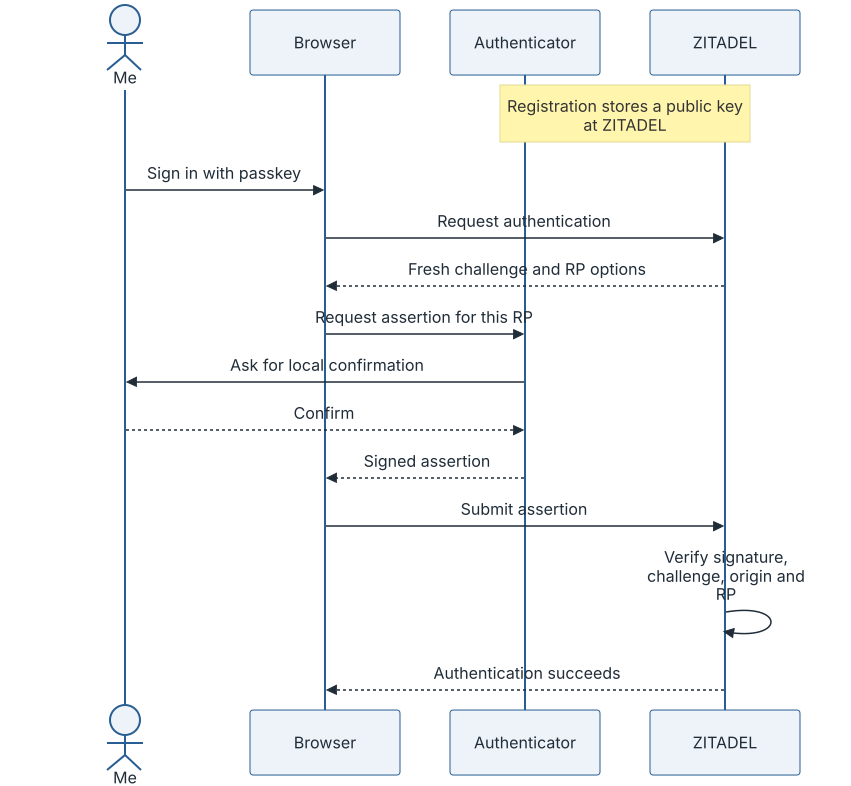
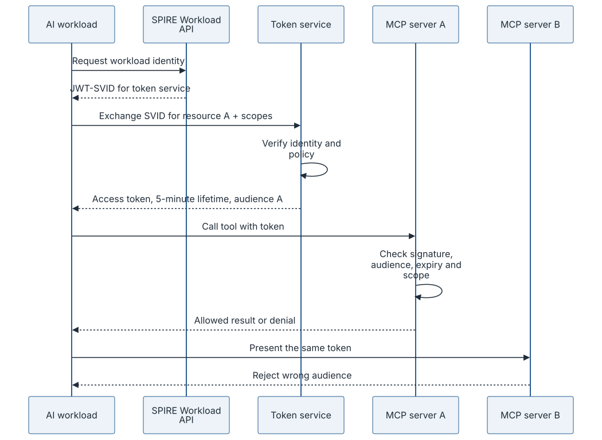
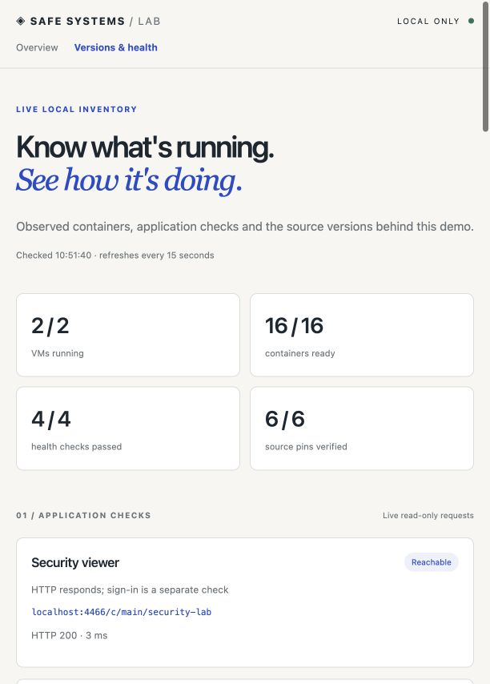

# Goodbye, SMS. Goodbye, Passwords.

*Passkeys for the human. Short-lived identity for the agent. And one permissions error that kept the demo honest.*

I wanted to open my own security lab without inventing another password.

That sounds like a small requirement. Usually it becomes a password policy, a reset flow, a six-digit code, and a phone number that somehow acquires responsibility for the whole operation. Then we give the AI agent an API key that lives longer than the laptop it was created on.

I am building a different path in my local lab: a passkey for my sign-in, and short-lived credentials for the workloads. No password or SMS step in this human login flow. No static agent API key in the tested workload flow.

There is an important footnote hiding in that sentence: a passkey itself contains a durable private key. I have not abolished secrets. I want fewer reusable bearer secrets copied into places where they do not belong.

## What actually happens when I use a passkey

The screen asks for a fingerprint, a device PIN, or another supported local confirmation. The website does not receive my fingerprint or PIN. That check unlocks the authenticator's use of a cryptographic key. [FIDO explains this separation](https://fidoalliance.org/passkeys/).

During registration, the authenticator creates a key pair for the relying party, the service accepting my login. The service stores the public key and credential information. It does not receive the private key as a login secret. [FIDO describes the public-key model](https://fidoalliance.org/passkeys/).

On a later sign-in, the service sends a fresh challenge. The browser checks the relying-party context. After my confirmation, the authenticator signs a response. The service verifies the signature, challenge, expected origin, relying-party ID and required user-verification flags. The signed data covers the challenge and origin through the client-data hash, alongside authenticator data containing the relying-party ID hash. [WebAuthn defines the registration and assertion checks](https://www.w3.org/TR/webauthn-3/#sctn-rp-operations).

*Illustration: a simplified passkey sign-in, following the [ZITADEL challenge and verification flow](https://zitadel.com/docs/guides/integrate/login-ui/passkey). The private key is not sent to ZITADEL.*

A fake login page on an unrelated domain cannot simply ask the browser for the real site's passkey. That origin and relying-party binding is the useful difference from typing a secret into whatever rectangle looks convincing today. Proper verification is essential; drawing a fingerprint icon on a login form does not add it.

The key might be device-bound, for example on a security key, or synced through a passkey provider. “The private key never leaves this particular device” is therefore not a promise I can make about every passkey. Storage, synchronization and recovery depend on the authenticator and provider. [FIDO distinguishes the two models](https://fidoalliance.org/white-paper-fido-deploying-passkeys-in-the-enterprise-introduction/).

## Why I am leaving SMS out of this flow

First, two different things deserve different names.

Sending an actual password by SMS distributes a reusable secret through a message. Sending an SMS one-time code is an authentication mechanism with a shorter validity window. Those are not equivalent, but neither gives me the relying-party binding of a passkey.

An attacker can persuade a person to type an SMS code into a phishing page and relay it while it is still valid. SIM swapping can move delivery to an attacker-controlled SIM. A short expiry helps with how long a code works; it does not establish which website is receiving it. [CISA describes these weaknesses in SMS and voice MFA](https://www.cisa.gov/sites/default/files/2023-01/fact-sheet-implementing-phishing-resistant-mfa-508c.pdf).

NIST SP 800-63B-4 treats authentication over the public telephone network, including SMS, as **restricted**. That is a risk-managed category, not a declaration that every use is forbidden. Its guidance calls for alternatives and migration planning, and identifies WebAuthn as a phishing-resistant mechanism through verifier-name binding. [NIST's authenticator guidance](https://pages.nist.gov/800-63-4/sp800-63b/authenticators/).

My choice for this new lab flow is to avoid adding SMS as either the normal login method or an easy recovery bypass. Recovery still needs a design. Otherwise we build a good front door and leave a phone-number-shaped side entrance.

## The human and the agent have different identities

In the lab, ZITADEL handles my passkey sign-in. The browser uses WebAuthn; the application uses OpenID Connect. These are separate steps: proving control of my authenticator, then conveying the authentication result to the application. ZITADEL's [passkey integration guide](https://zitadel.com/docs/guides/integrate/login-ui/passkey) shows the challenge and verification operations behind that interaction.

The Security viewer is intended to be read-only. Its gate checks an explicitly approved stable subject and the expected viewer role, alongside the authentication requirements. A successfully enrolled passkey does not automatically approve an account.

*Illustration: the intended human access path. Successful authentication alone does not establish usable resource access.*

The AI agent has its own path. It does not borrow my browser session, receive my passkey, or inherit my viewer role. In the current proof of concept it acts as its own workload, not as my delegated representative.

[In `mcp-svid-auth`](https://github.com/tanya-ok/mcp-svid-auth), the agent obtains a SPIFFE JWT-SVID and exchanges it for an OAuth access token. SPIFFE's [JWT-SVID specification](https://spiffe.io/docs/latest/spiffe-specs/jwt-svid/) requires audience and expiration checks, and explicitly warns that these are bearer tokens with replay risk.

My demo adds concrete boundaries: a 60-second SVID in the configured scenario, a five-minute access token, one target MCP resource, and tool scopes. These lifetimes are choices in this implementation, not universal SPIFFE defaults.

*Illustration: the tested workload credential path. A server needing an upstream call obtains its own credential rather than forwarding the incoming token.*

A stolen bearer token can still be used within its allowed scope and lifetime. The integrated demo also permits JWT-SVID reuse within its lifetime because of the pinned SPIRE agent's caching behavior. That is a recorded limitation, not something a five-minute expiry makes disappear. The [project security notes](https://github.com/tanya-ok/mcp-svid-auth/blob/main/docs/security.md) describe the trade-off.

## The part the screenshot does not prove

I collect the projects in a local `agent-security-lab` panel: start, stop, service health, pinned versions and safe log views. The panel is useful because a demo becomes much less mysterious when I can see which component is actually running.

*Real screenshot from an earlier local run: the local runtime panel during an earlier run. This is historical service-health evidence, not the current runtime state and not proof of passkey authentication.*

A bounded log view helps investigate a failure; it does not establish that every authorization boundary works.

In the first manual check I completed real passkey enrollment and native sign-in with a separate local operator account in Brave. The key was registered successfully. Then the viewer's resource pages returned: **“You don't have permissions to view this resource.”**

An excellent way to stop a premature success announcement.

At that point, I had a narrow success and an unresolved failure: the passkey ceremony and native identity-provider sign-in worked; useful access to the protected resource views did not. At that point I still needed to trace the resource-access failure. A denial caused by a misconfiguration is not automatically evidence that the intended policy works.

In a later check in Brave, sign-in with the existing passkey succeeded, and Pods, Deployments and Services opened. The demonstration remains local. The screenshot above still comes from an earlier run. I have not tested real Google sign-in, and none of this is a production deployment or certification.

## What I want to keep, and what I want to remove

I want to keep the durable, protected key that proves control of my authenticator. I want to remove passwords and SMS codes from this login path, and static API keys from the agent's runtime configuration.

I also want the uncomfortable details visible: account recovery, revoked access, expired credentials, failed refresh, and an identity that signs in successfully but still cannot open a resource.

The local runtime still has provisioning credentials and service infrastructure to protect. A passkey does not erase those. It also does not make a compromised browser trustworthy or turn an agent's authenticated request into a good decision. In the MCP demo, an injected write is denied with a read-only scope and succeeds with a write scope. Identity can identify the caller; it cannot decide whether the caller should have followed that instruction.

I later traced the resource failure to a concrete mismatch: Headlamp was asking for cluster-wide resource lists, while the viewer had permission to read only the lab namespaces. I set explicit namespace defaults and left Kubernetes RBAC unchanged. A fresh browser then displayed Pods, Deployments and Services in a separate test VM. Secrets, unrelated namespaces and writes still failed. The [pinned Headlamp settings contract](https://github.com/kubernetes-sigs/headlamp/blob/v0.45.0/frontend/src/helpers/clusterSettings.ts) is a browsing preference, not an authorization grant.

The full 18-scenario security demo passed there, and I stopped the test VM afterward. That test used the standalone viewer. The later combined passkey and resource-browsing check passed in the original lab. It did not repeat those denial tests. Restarting the original lab also exposed another problem: temporary identity bootstrap and SPIRE state needed manual recovery. The passkey and authorization policy survived. I added a narrow restart path and tested it with another controlled VM stop/start, followed by all 18 security scenarios. It preserves the existing passkey record and restores only the known lost workload state. Unknown state or a failed policy check stops startup without resetting the profile. That is a tested local restart path, not a finished account-recovery design.

I would like fewer passwords to rotate, fewer secrets to copy, and smaller windows in which a stolen runtime credential is useful. A login screen saying “You are signed in” is a start. I still want to know what that identity can actually do.
