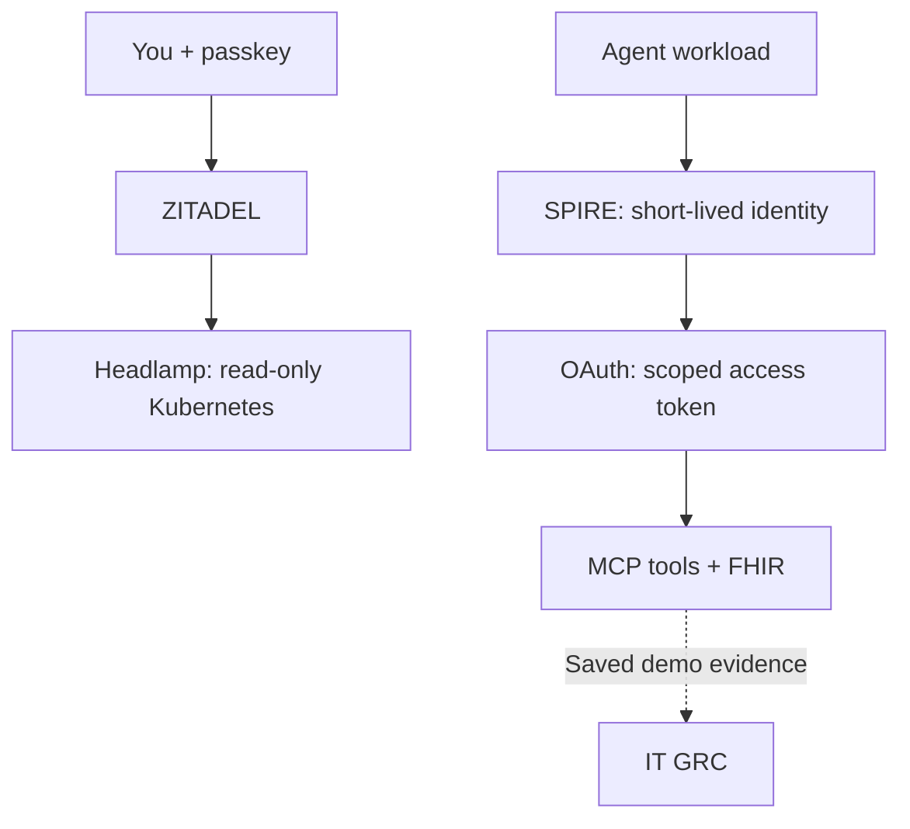

# Agent Security Lab

**Passkeys for people. Short-lived identity for agents. Evidence you can inspect.**

One local panel brings six security projects together. Start demos, browse Kubernetes,
check health and versions, and inspect bounded diagnostics.



| Part | Why it is here |
|---|---|
| [Headlamp](https://headlamp.dev/) | Browse Pods, Deployments and Services; [CNCF Sandbox project](https://www.cncf.io/projects/headlamp/). |
| [Lima](https://lima-vm.io/) + [k3s](https://k3s.io/) + [containerd](https://containerd.io/) | Owned local Linux VMs, Kubernetes and container runtime. Docker Desktop and Docker Engine are not required. containerd is a [CNCF Graduated project](https://www.cncf.io/projects/containerd/). |
| [Buildah](https://buildah.io/) | Build OCI container images inside the lab VM. |
| [ZITADEL](https://zitadel.com/) + [passkeys](https://fidoalliance.org/passkeys/) | Human sign-in with WebAuthn and OIDC; no password or SMS step in the viewer flow. |
| [SPIFFE / SPIRE](https://spiffe.io/) | Workload identity exchanged for short-lived, resource-bound OAuth tokens. No static agent API key in the tested flow. |
| [Beads](https://github.com/gastownhall/beads) | Local task and dependency tracking; filtered roadmap export. |
| [Zensical](https://zensical.org/) | This documentation site, built locally and prepared for GitHub Pages. |

The passkey itself is a durable cryptographic credential. Provisioning credentials
still exist locally; the claim is scoped to the human viewer and workload flows.

[Try the demos](manual-walkthrough.md) · [Architecture](architecture.md) ·
[Owner acceptance](viewer-owner-acceptance.json) · [Restart recovery](restart-recovery.md) ·
**Publication is held pending private review and owner approval.**

[Publication review](publication-plan.md) · [Development models](development-models.md)

## Local preview

```sh
uv sync --locked --group docs
uv run --locked --group docs zensical serve
```

GitHub Pages is a planned destination. This preparation has not published a site.
No production readiness or certification is claimed.
