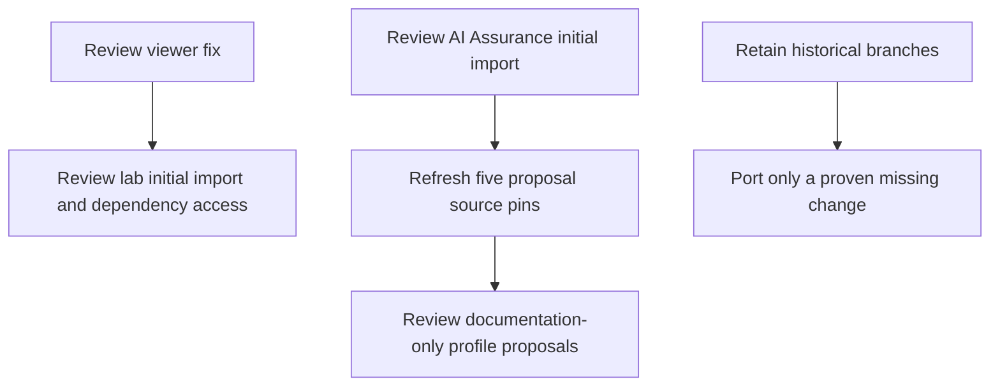

# Portfolio PR review

**Local preparation only. No PRs or remote writes.**

Twenty-two working heads were compared with freshly read main references:
6 clean native merges, 8 conflicting native merges, 5
unrelated histories, 1 tree already identical to main, and 2 initial imports
without a published main. A squash is not a rebase or compatibility proof.

| Project | Current main | Recommended PR scope |
|---|---|---|
| [mcp-svid-auth](pr-drafts/mcp-svid-auth.md) | `84a38c4` | Viewer fix; separate assurance proposal/package exclusion |
| [hipaa-fhir-mcp](pr-drafts/hipaa-fhir-mcp.md) | `61c844a` | Assurance evidence-plan documentation only |
| [mcp-spiffe-bridge](pr-drafts/mcp-spiffe-bridge.md) | `ba5a6be` | Node-only assurance proposal; private CI collector deferred |
| [engineering-os](pr-drafts/engineering-os.md) | `abcabe1` | Assurance proposal; separate ownership documentation port |
| [it-grc](pr-drafts/it-grc.md) | `b7ac7b3` | Assurance proposal only; old feature tree already equals main |
| [ai-assurance](pr-drafts/ai-assurance.md) | No published main | Initial import; source-pin/publication gates remain |
| [ecs-contract](pr-drafts/ecs-contract.md) | `2094c60` | No source PR from old snapshots |
| [agent-security-lab](pr-drafts/agent-security-lab.md) | No published main | Initial import after viewer/dependency review |

## What passed

All six native merge trees equal their checked branch trees. Existing same-day
functional checks were reused only after that equality check. Fresh validation
also covered the combined viewer/proposal tree, the remaining proposal PR-template
gates and strict documentation builds. Referenced proposal evidence files and
workflow/job names exist. This establishes local compatibility, not a successful
GitHub workflow or real CI evidence for installation.

## What must stay out

The old FHIR and bridge Kubernetes snapshots have no runtime delta from main;
their extra assurance scaffolds are not the current proposal format. The old
ECS development snapshot likewise adds no runtime change. Other snapshots can
remove current security guards, restore Docker/Podman paths, remove secret-scan
scripts or replace newer package configuration. Do not resolve these by accepting
one side wholesale. Keep old branches and backups; port only a separately proven
missing change from current main.

## Source and publication dependencies

The five assurance proposals merge cleanly but still name the pre-consolidation
source commit. Their bundle/runtime files match the current initial-import head;
the old Git object is not automatically publishable with the new single root.
Refresh to the actual published reviewed commit before opening those PRs.
Installation, applicability approval and execution evidence remain separate.
Private CI cannot currently be collected by the public-only verifier.

Open the individual project reviews above for English titles, proposed PR bodies,
checks and opening gates. Nine draft PR bodies are prepared across seven projects;
ECS Contract has an explicit no-PR decision instead of an invented change.

## Suggested review order

## Selected changes on current main

[Selective port results](selective-ports.md) records all fourteen legacy
dispositions. One new documentation branch was selected; old runtime snapshots
remain historical. Original branches and worktrees are preserved.

[Local model review](local-model-review.md) records two completed quorum batches,
bounded coverage and publication limits. Detailed findings stay in private local review.
