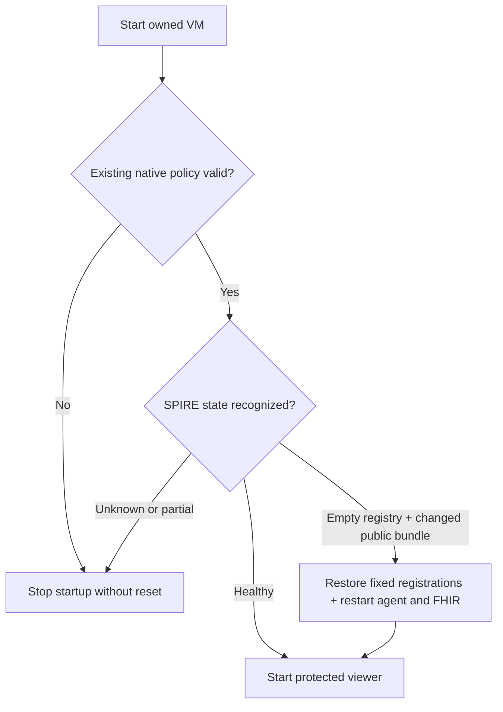

# Restart without losing the operator passkey

**A VM restart reuses the saved profile. Explicit teardown still removes it.**

| Preserved | Allowed recovery |
|---|---|
| Existing operator account, passkey, role and subject approval | Verify native policy using the existing Login service credential, in memory only |
| Namespaces and VM disks | Restore the pinned workload registrations only for the recognized empty-memory state |
| GRC data | Leave the GRC VM and persistent storage intact |

There is no credential renewal, role grant, weaker login fallback or automatic
namespace deletion. Foreign ownership, failed policy checks and unknown trust
state stop startup. A partial recovery remains a failed run, never a reset.

The panel's **Start stack** and `./lab up` use the same checks. **Stop stack** and
`./lab down` are explicit teardown: they still delete disposable security and
identity namespaces. Preserve a manually enrolled profile by stopping only its
owned VM when performing a controlled restart test; this is not a recovery button
for unknown authentication errors.

[Recorded verification](restart-validation.json): controlled VM stop/start,
18 post-restart security scenarios, 16/16 ready containers, 4/4 healthy application
checks and 6/6 verified source pins. Existing passkey metadata and profile bytes
were preserved. No physical authenticator ceremony was repeated after this restart.
